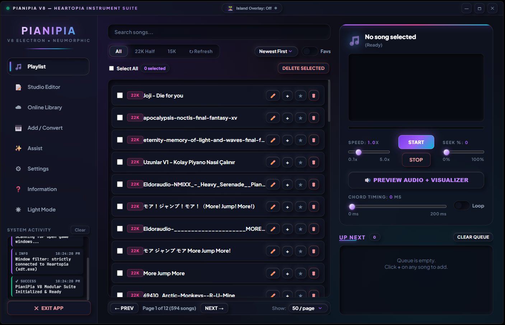
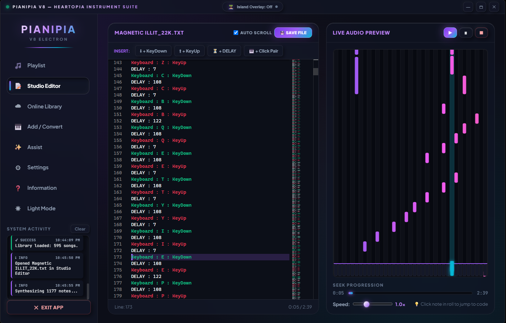
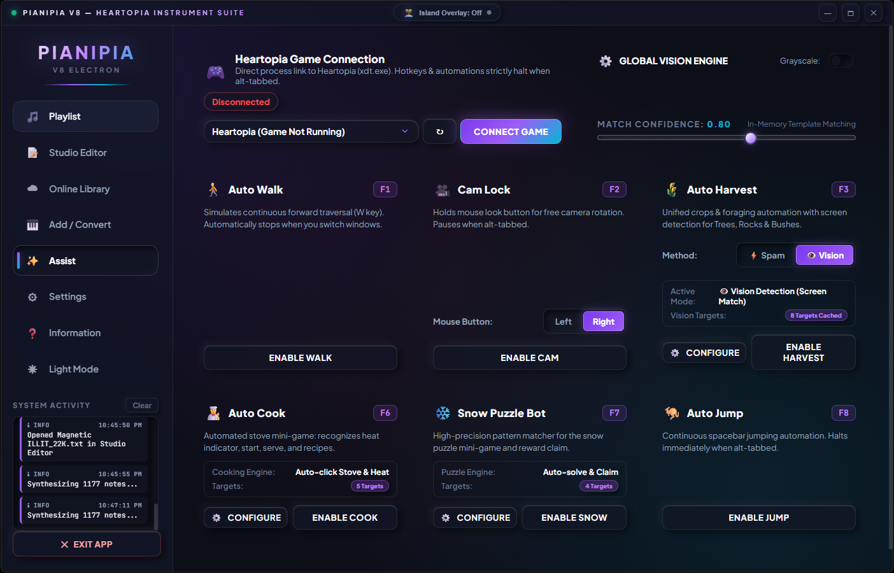
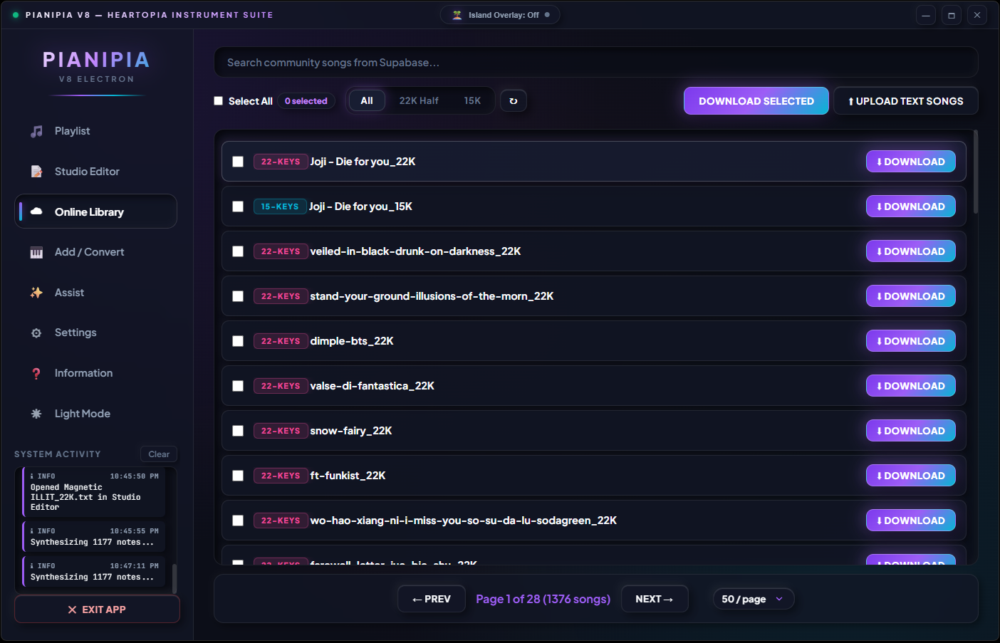
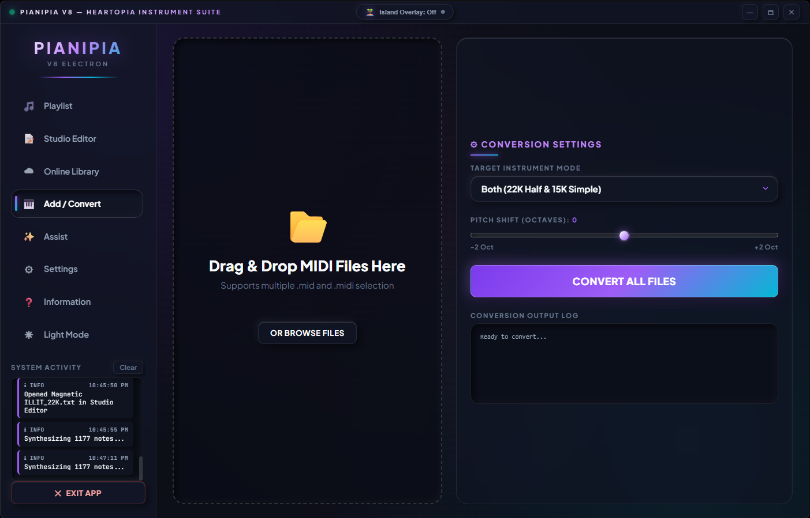
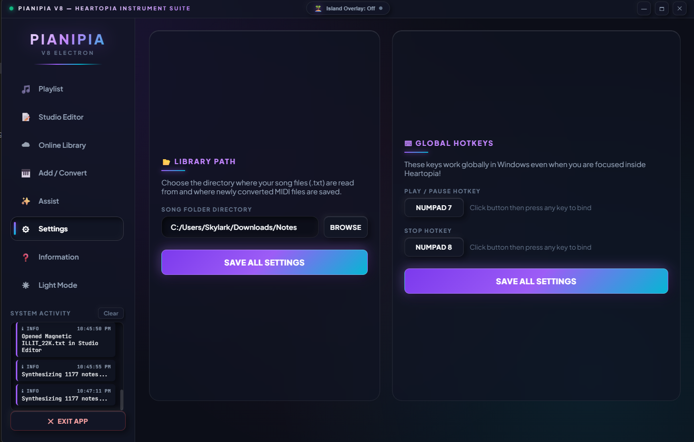

<div align="center">
  <h3>✨ Visit my personal Wiki ✨</h3>
  <a href="https://heartopia-wikios.vercel.app/"></a>
</div>
<br>

<h1 align="center">PianiPia (Open Source)</h1>
<p align="center">
  <b>The Ultimate Automated Piano Player & Assist Suite for Heartopia</b><br>
  🔓 Open Source • ⚡ Electron Desktop • 🐍 Python Hybrid • 🤖 Made with AI • 🎵 Studio Editor • 🎹 Visual Piano Roll • ✨ Game Assist
</p>

<p align="center">
  
  
  
  
  
</p>

<p align="center">
  <a href="https://github.com/KaleidSkylark/Heartopia-Instrument-MIDI/actions"></a>
</p>

<p align="center">
  <a href="https://github.com/KaleidSkylark/Heartopia-Instrument-MIDI/actions"><b>⚡ GitHub Actions Builds</b></a> •
  <a href="#-versions-overview">Versions Overview</a> •
  <a href="#-interface-preview">Interface Preview</a> •
  <a href="#-running-from-source">Run from Source</a> •
  <a href="#-building-executables-exe">Build .exe</a> •
  <a href="#-features">Features</a> •
  <a href="#-how-to-use">How To Use</a> •
  <a href="#-important-antivirus-false-positives-for-exe-users">Antivirus Info</a> •
  <a href="#-repository-structure">Structure</a> •
  <a href="#-patch-notes-history">Patch Notes</a>
</p>

---

### 🚀 Now Fully Open Source!

PianiPia is now **100% open source**! You can inspect every line of code, run directly from Python or Node without relying on pre-packaged executables (avoiding antivirus false positives entirely), customize shortcuts, or build your own custom distributions.

---

### 📸 Interface Preview

<div align="center">
  <h4>🎹 Playlist & Interactive Visual Piano Roll</h4>
  
</div>
<br>

<div align="center">
  <h4>📝 Monaco Studio Editor with Live Synthesizer Preview</h4>
  
</div>
<br>

<div align="center">
  <h4>🌾 Assist Automation Suite (Auto Harvest, Cook, Fish, Walk & Cam Lock)</h4>
  
</div>
<br>

<div align="center">
  <h4>☁️ Community Cloud Library (Search, Upload & Batch Download)</h4>
  
</div>
<br>

<div align="center">
  <h4>🎵 Fast MIDI Converter & Pitch Folding (22-Keys & 15-Keys)</h4>
  
</div>
<br>

<div align="center">
  <h4>⚙️ Global Hotkeys & Native Settings</h4>
  
</div>

---

### 📦 Versions Overview

This repository contains **V6**, **V7**, and **V8** source trees:

| Version | Focus | Included Features |
| :--- | :--- | :--- |
| **[V8 (Electron)](V8-Electron/)** <br>*(Flagship Desktop)* | **Modern Dedicated Desktop Suite** | • Dedicated desktop app with frameless Win11 snap layout titlebar<br>• 🏝️ Dynamic Island top-of-screen floating overlay for playing in fullscreen<br>• 📝 Monaco Studio Editor with live piano-roll sync & real-time audio synthesizer preview<br>• 🌾 Auto Harvest (⚡ Spam + 👁️ Multi-Sample Vision Matching for Trees, Rocks & Bushes)<br>• 🎮 Full Assist Engine (Auto Cook, Snow Puzzle, Auto Walk, Cam Lock, Auto Jump, Build Glitch)<br>• ☁️ Community Cloud & MIDI Converter (22K & 15K folding)<br>• 🛡️ Native Windows background hotkey engine with debounce safety |
| **[V7](V7/)** | **Full Automation & Assist Suite** | • Everything in V6, **plus** the complete in-game **Assist System**:<br>  - 🚶 Auto Walk & 📷 Cam Lock<br>  - 👨‍🍳 Auto Cook (visual heat detection)<br>  - ❄️ Snow Puzzle Mini-Game Solver<br>  - 🚜 Auto Harvest (Hold & Spam modes)<br>  - 🦘 Auto Jump<br>  - 🎣 Fish Automation & 🛠️ Build Glitch trigger |
| **[V6](V6/)** | **Ultra-Lightweight & Focused** | • Complete MIDI Player & visual piano roll<br>• Monaco Studio Editor (1M+ lines)<br>• Community Cloud (upload/download)<br>• 22K & 15K MIDI converter<br>• Fully debloated (no OpenCV or bot dependencies) |

---

### 💻 Running from Source

You can run PianiPia directly using Python on Windows:

#### 1. Prerequisites
- **Python 3.10 or higher** installed ([python.org](https://www.python.org/downloads/))
- During Python installation, ensure **"Add python.exe to PATH"** is checked.
- **Node.js 18 or higher** (for V8 Electron desktop app): ([nodejs.org](https://nodejs.org/))

#### 2. Clone the Repository
```bash
git clone https://github.com/KaleidSkylark/Heartopia-Instrument-MIDI.git
cd Heartopia-Instrument-MIDI
```

#### 3. Create & Activate a Virtual Environment
```bash
python -m venv venv
venv\Scripts\activate
```

#### 4. Install Dependencies

**For V8 (Flagship Electron Desktop):**
```bash
pip install pydirectinput pyautogui pynput pillow mido supabase
cd V8-Electron
npm install
```

**For V7 (Full Suite with Game Assist):**
```bash
pip install flask flask-socketio simple-websocket pydirectinput pyautogui pynput pillow mido supabase
```

**For V6 (Lightweight Music Player):**
```bash
pip install flask flask-socketio simple-websocket pydirectinput mido supabase
```

#### 5. Launch the Application

- **To run PianiPia V8 (Dedicated Desktop App):**
  ```bash
  cd V8-Electron
  npm start
  ```

- **To run PianiPia V7:**
  ```bash
  python V7/PianiPiaV7.py
  ```

- **To run PianiPia V6:**
  ```bash
  python V6/PianiPiaV6.py
  ```

For V6 and V7, your default web browser will automatically open to `http://127.0.0.1:5000` with the UI ready to go! For V8, the dedicated desktop window launches directly.

---

### 🏗️ Building Executables (.exe)

If you want to package the app into a standalone `.exe`:

#### Building V8 (Electron Desktop)
From the repository root, simply run:
```bash
build_v8_exe.bat
```
Or inside the `V8-Electron/` folder:
```bash
cd V8-Electron
build_exe.bat
```
The standalone portable executable `PianiPia_V8_Portable.exe` will be generated inside `V8-Electron/dist/`.

#### Building V6 (Python / PyInstaller)
```bash
pip install pyinstaller
cd V6
build_bot_modular.bat
```

---

### ✨ Core Features

> ⚠️ **Note:** Heartopia needs to be foreground/active for key simulation to register in-game. Run as Administrator if keystrokes are blocked.

* **🎵 Accurate Auto-Player:** Plays complex multi-track MIDI scripts using direct keyboard emulation.
* **📝 Monaco Studio Editor:** VS Code's Monaco engine built-in. Smoothly edits 1,000,000+ line MIDI scripts with real-time cursor sync.
* **🎹 Visual Piano Roll:** Live interactive canvas visualizer tracking your code lines in real-time. Click any note to jump directly to code.
* **☁️ Community Cloud:** Search, download, and share song scripts directly from within the app.
* **✨ Game Assist (V7 & V8):** Comprehensive image-recognition and automation suite for cooking, puzzle solving, farming, and camera navigation.
* **🏝️ Dynamic Island Overlay (V8):** Minimalist always-on-top HUD pinned to the top of your screen showing playback progress and quick controls.
* **🌾 Auto Harvest Multi-Sample Vision (V8):** High-speed spamming or RAM-cached vision detection for trees, rocks, and bushes. *(Tip: The more sample images captured across angles and lighting, the higher the vision detection accuracy!)*

---

### 📂 Repository Structure

```text
Heartopia-Instrument-MIDI/
├── .github/
│   └── workflows/
│       └── build.yml           # Automated GitHub Actions build workflow
├── V8-Electron/               # PianiPia V8 (Electron Desktop Application)
│   ├── main.js                 # Electron main process & IPC coordinator
│   ├── python_bridge.py        # Python automation & playback engine
│   ├── package.json            # Electron dependencies & builder config
│   ├── build_exe.bat           # Executable packaging script
│   ├── logo.ico                # App icon
│   ├── heartopia_modules/      # Modular backend & assist engine
│   └── renderer/               # Desktop UI (HTML5, CSS3, JS Modules)
├── V6/                         # PianiPia V6 (Dedicated Music Player)
│   ├── PianiPiaV6.py           # V6 Entry point
│   ├── build_bot_modular.bat   # PyInstaller build script
│   ├── config.json             # V6 player configuration
│   └── heartopia_modules/      # Modular backend (routes, player, editor, converter)
├── V7/                         # PianiPia V7 (Music Player + In-Game Assist)
│   ├── PianiPiaV7.py           # V7 Entry point
│   ├── HeartAssist.py          # Standalone assist automation engine
│   ├── config.json             # V7 player & assist settings
│   ├── build glitch/           # Reference assets for build glitch helper
│   └── heartopia_modules/      # Modular backend + assist module & web UI
├── CookingReference/           # Default template images for Auto-Cook recognition
├── SnowReference/              # Default template images for Snow Puzzle solver
├── Tree&Rock&BushReference/    # Default template images for Auto Harvest vision
├── images/                     # Screenshot previews for README & documentation
├── build_v8_exe.bat            # Root launcher for building V8 executable
├── PianiPiaV6.exe              # Pre-compiled V6 standalone executable
└── README.md
```

---

### 🛠️ Patch Notes History

#### V8.0 Major Desktop Release (Electron Desktop Suite)
* **✅ Electron Desktop Architecture:** Dedicated standalone desktop application with frameless Win11 snap layout titlebar.
* **✅ Dynamic Island Floating Overlay:** Minimalist always-on-top pill overlay for playing games in borderless/fullscreen with live controls.
* **✅ Monaco Studio & Live Audio Preview:** Upgraded Monaco editor with live synchronized canvas piano roll keys and real-time audio synthesizer preview.
* **✅ Auto Harvest Engine (Spam & Multi-Sample Vision):** Dual-mode harvesting with instant RAM-cached template matching for trees, rocks, and bushes.
* **✅ Cleaned Global Hotkey System:** Native Windows background hotkeys (`GetAsyncKeyState`) with strict debounce filters to eliminate key leaks and duplicate triggers.
* **✅ Transparent GitHub Actions CI:** Automated build workflow for 100% transparency and verified cloud compilation.

#### V7.0 Major Automation Release
* **✅ Modular Architecture:** Refactored into clean `heartopia_modules` with modular routes, player, config, and hotkey listeners.
* **✅ Full Assist Integration:** Added in-app Assist tab directly into the Web UI.
* **✅ Auto Cook & Snow Puzzle:** Integrated computer vision detection for cooking cycles and snow puzzles.
* **✅ Auto Harvest & Auto Jump:** Added hold/spam modes for harvesting and jumping traversal.
* **✅ Build Glitch Trigger:** Added simultaneous icon manipulation for build glitch shortcuts.
* **✅ Open Source:** Entire codebase opened up for community contribution and direct Python execution.

#### V6.0 Optimization & UI Overhaul
* **✅ Storage & Performance Optimization:** Cleaned up dependencies for a streamlined music experience. Size dropped to 24MB.
* **✅ Amoled Neon UI:** Redesigned interface with vibrant Amoled dark theme and responsive layout.
* **✅ Playlist Filters:** Added multi-select, quick filters, and refreshed search.
* **✅ Monaco Studio Editor:** Ultra-fast editor handling massive song scripts with live visual seek.

#### V5.2 Converter Intelligence Update 
* **✅ 15K Smart Pitch Folding:** Notes outside the 15-key range fold gracefully instead of being discarded.
* **✅ Zero Dropped Notes:** Every note from source MIDI is preserved for full rhythm density.
* **✅ Tap Mode Logic:** Eliminates ghost notes and de-sync issues on fast tempos.

#### V5.1 Hotfix & Improvements
* **✅ 500KB Upload Limit:** Increased upload limit for complex multipart scripts.
* **✅ Smart Pagination:** Custom per-page selection (50/100/200/300) in Online tab.
* **✅ Filename Sanitization:** Fixes illegal OS characters on download.

---

### ⚠️ Important: Antivirus False Positives (For .exe Users)

**Is the `.exe` safe? Yes.**

If you run the pre-compiled `.exe`, antivirus programs (Windows Defender, Avast, etc.) may flag it.

**Why does this happen?**
1. **Input Simulation:** The app uses Windows input APIs (`pydirectinput`, `pyautogui`) to press keys in games. Antivirus heuristics frequently flag keyboard automation as a keylogger or Trojan.
2. **Unsigned Executable:** Independent open-source projects lack expensive code-signing certificates.
3. **PyInstaller Packing:** PyInstaller binaries are commonly flagged by heuristic scanners.

> 💡 **Best Solution:** Since PianiPia is **Open Source**, you can run directly from Python source (`python V6/PianiPiaV6.py` or `python V7/PianiPiaV7.py` or `npm start` in `V8-Electron/`). Running raw Python scripts bypasses binary scanner false positives completely!

#### 🛡️ Complete Transparency via GitHub Actions CI
To give everyone 100% peace of mind:
* This project includes an automated GitHub Actions build workflow at [`.github/workflows/build.yml`](.github/workflows/build.yml).
* Every executable can be built and verified directly on GitHub's clean cloud virtual machines.
* You can fork this repository, click **Run workflow** under the **Actions** tab, and download your own independently compiled `.exe` artifact directly from GitHub.

<p align="center">
  <a href="https://github.com/KaleidSkylark/Heartopia-Instrument-MIDI/actions">
    
  </a>
</p>

If you prefer using the `.exe`:
1. Create a dedicated folder (e.g. `C:\Games\PianiPia`).
2. Add that folder as an exclusion in **Windows Security** > **Virus & threat protection settings** > **Exclusions**.
3. Place and run the executable inside that folder.

---

### 📖 How to Use

1. **Launch:** Run `build_v8_exe.bat` or `npm start` in `V8-Electron/` (or run `python V6/PianiPiaV6.py` / `python V7/PianiPiaV7.py`). For V6/V7, the browser UI opens at `http://127.0.0.1:5000`.
2. **Get Songs:**
   * **☁️ Online Tab:** Search the cloud library and click download.
   * **🎹 Add / Convert Tab:** Drag and drop `.mid` files to automatically generate 22K or 15K scripts.
3. **Play:**
   * In **Playlist**, add songs to the **Queue**.
   * Focus Heartopia in the foreground.
   * Press **Start Key (Default: NUMPAD7 or F4)** to begin playing.
   * Press **Stop Key (Default: NUMPAD8 or F5)** to halt.
4. **Assist (V7 & V8):**
   * Go to the **✨ Assist** tab.
   * Select the game window from the dropdown and click **Connect**.
   * Toggle Auto Walk, Cam Lock, Auto Cook, Auto Harvest, or Snow Puzzle as needed.

---

<p align="center">
  Made with ❤️ by <a href="https://github.com/KaleidSkylark">KaleidSkylark</a>
</p>
